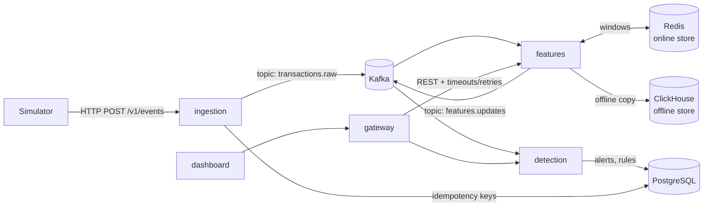

# FeatureStore

Fault-tolerant real-time feature storage and serving system for anomaly detection in
payment transaction streams.

Diploma project — European Humanities University, Software Development Center.
Author: Viacheslav Voiteshonok. Supervisor: Andrii Kostromytskyi.

## What it does

The system ingests a continuous stream of payment transactions, computes sliding-window
features per card and per merchant (counts, sums, decline rates, geo-velocity), serves
them with millisecond latency to an anomaly-detection consumer, and raises alerts on a
dashboard — while tolerating failures of the broker, the stores, and the services
themselves.

## Architecture



- **ingestion** — accepts payment events over HTTP, tokenizes PANs (HMAC, ADR-009),
  deduplicates by `event_id` (Postgres-backed idempotency store, ADR-003), publishes
  to Kafka. Degrades to `503 + Retry-After` when Kafka is down (ADR-006).
- **features** — consumes `transactions.raw`, maintains sliding windows in Redis
  (ADR-002), serves feature vectors over REST, publishes `features.updates`, writes
  the offline copy to ClickHouse (ADR-001, ADR-004).
- **detection** — consumes feature updates, evaluates alert rules stored in Postgres,
  persists alerts.
- **gateway** — single entry point: routing, authentication, rate limiting (ADR-008).
- **simulator** — reproducible load generator (seeded, Luhn-valid PANs, geo profiles).

Service boundaries, contracts and the full deployment diagram: see
[docs/architecture.md](docs/architecture.md). Design decisions: [docs/adr/](docs/adr/).

## Status

| Component | State |
| --- | --- |
| ingestion | done — API, idempotency, Kafka publisher, PAN tokenization, tests |
| simulator | done |
| libs/schemas (contracts) | done — event, snapshot and catalog contracts, contract tests |
| infra (compose, Kafka, Postgres, Redis, ClickHouse) | done |
| features | done — worker (Redis windows, watermarks, snapshots) + api (serving, ADR-013 freshness), two images (ADR-007) |
| detection | done — rule evaluation over snapshots, alert lifecycle API, audit via DB trigger |
| gateway | done — routing, API-key auth, rate limiting, timeouts/retries, request ids |
| PostgreSQL OLTP (schemas, roles, seed) | done — infra/postgres, docs/db |
| e2e | stage 2 and stage 3 flows (tests/e2e) |
| dashboard | planned |

## Quickstart

Requirements: Docker + Docker Compose, `uv`, Python 3.12.

```bash
make secret        # generate the local HMAC key (never committed)
make up            # kafka, postgres, redis, clickhouse, topics, ingestion
make ps            # check health
make baseline-up   # SQL measurement stand on :8003 (ADR-015); not a service, not started by make up
# send traffic:
docker compose -f infra/docker-compose.yml --profile sim up simulator
```

Run checks locally:

```bash
make lint typecheck test   # ruff, mypy, unit tests
make test-int              # integration tests (require docker)
```

Interactive API docs: ingestion http://localhost:8000/docs, features
http://localhost:8001/docs, detection http://localhost:8002/docs, gateway
http://localhost:8080/docs (requests need `X-API-Key`, dev keys in
`infra/.env.example`) — exported specs in [docs/openapi/](docs/openapi/).

## Metrics

Prometheus is optional and scrapes metrics ports (ADR-014), including the
baseline processes when that profile is up. `make up` does not start it.

```bash
make up
make obs-up
```

UI: http://127.0.0.1:9090. Target health: http://127.0.0.1:9090/targets.

K1, feature-read latency p99:

```promql
histogram_quantile(0.99, sum by (le) (rate(features_request_duration_seconds_bucket[1m])))
```

K2, ingest-to-online p95:

```promql
histogram_quantile(0.95, sum by (le) (rate(features_event_to_online_seconds_bucket[1m])))
```

The same expressions are recorded as `features_request_duration_seconds:p99` and
`features_event_to_online_seconds:p95`.

## Repository layout

```
services/        one directory per microservice (own pyproject, Dockerfile, tests)
libs/schemas/    versioned message and API contracts (no business logic)
simulator/       load generator
infra/           docker-compose, Postgres/ClickHouse init scripts
docs/adr/        architecture decision records
docs/criteria/   diploma evaluation criteria — ADRs with compliance checklists
docs/db/         data dictionary, ER diagram
tools/           pan_scan — CI guard: no PANs in code or fixtures
```

## Security notes

- Raw PANs never cross the ingestion boundary: events carry an HMAC `card_token`
  (structurally enforced by the `TransactionEvent` contract), logs pass a PAN-masking
  filter, and `make pan-scan` runs in CI.
- No secrets in the repository: the HMAC key is a compose secret, DB credentials come
  from the environment (`infra/.env.example`).
- Services connect to Postgres under per-service accounts with least-privilege grants
  (`infra/postgres/`); the application never runs as a superuser.

## License

MIT — see [LICENSE](LICENSE).
