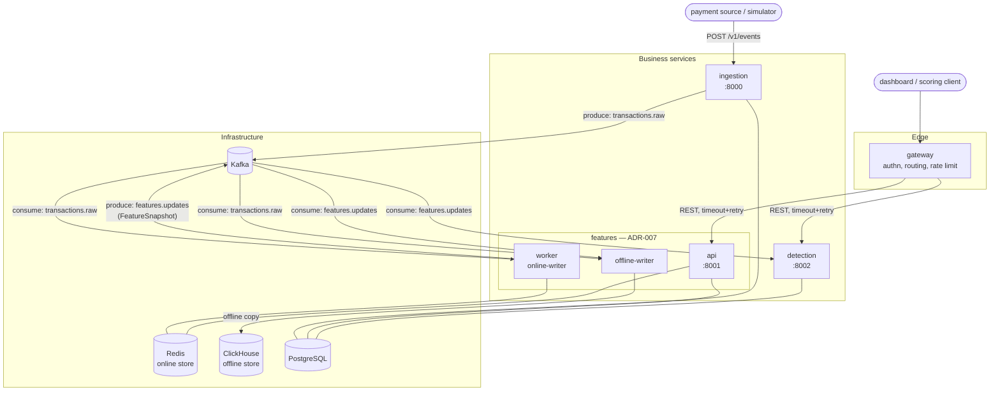
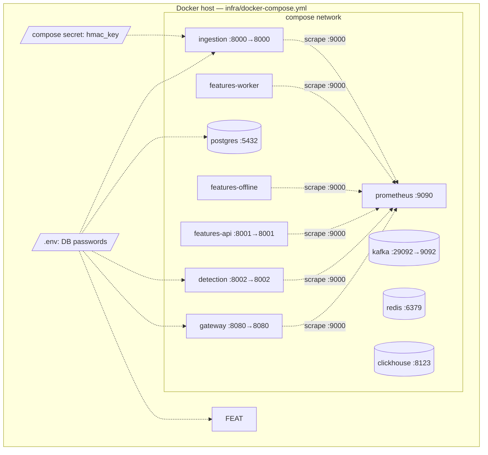

# Architecture

System: fault-tolerant real-time feature storage and serving for anomaly detection in
payment transaction streams. This page is the entry point for the Microservices and
Database evaluation criteria; decisions are recorded in [ADRs](adr/README.md).

## Bounded contexts and decomposition rationale

| Service | Bounded context | Owns (data) | Why a separate service |
| --- | --- | --- | --- |
| **ingestion** | Event acceptance: validation, PAN tokenization, deduplication, publish | `ingestion` schema (idempotency keys) | Security boundary — the only component that ever sees a PAN; must absorb client bursts and broker outages (ADR-006) independently of the read path |
| **features** | Feature computation and serving: sliding windows, online store, offline copy | Redis keys, ClickHouse tables, `features` schema (registry) | Latency-critical read path (P99 ms-level); scales with read traffic, not with ingest; independent online/offline writers (ADR-001, ADR-018). One package, two images — `worker` (online + offline consumers as separate processes) and `api` (serving) — so consumer load never touches API latency (ADR-007) |
| **detection** | Anomaly detection: rule evaluation, alert lifecycle | `detection` schema (rules, alerts) | Evolves independently (rules → ML model later); failure must not affect feature serving |
| **gateway** | Edge: routing, authn, rate limiting | — (stateless) | Single entry point; keeps cross-cutting edge concerns out of business services (ADR-008) |
| simulator | Load generation (dev/test only) | — | Reproducible traffic for demos and experiments |

Decomposition follows the data-flow stages of the domain, not entities: each service
has a distinct failure mode, load profile and scaling axis — the core claim of the
thesis (fault tolerance) is only demonstrable if the stages fail independently.

**No shared database:** each service owns its schema with per-service credentials and
least-privilege grants (see [db/data-dictionary.md](db/data-dictionary.md)). Redis and
ClickHouse are owned by the features service exclusively.

**`libs/schemas` is a contract package, not a shared business-logic library:** it
contains only versioned, frozen message/API models (Pydantic) and the declarative
feature catalog — the equivalent of an OpenAPI/AsyncAPI artifact, consumed by all
sides of each contract and covered by contract tests. All behaviour (tokenization,
windowing, rule evaluation) lives inside the owning service.

## Component diagram

## Communication

### Asynchronous (Kafka) — the backbone

| Topic | Producer | Consumers | Contract | Retention |
| --- | --- | --- | --- | --- |
| `transactions.raw` | ingestion | features (online + offline writers, independent consumer groups — ADR-001) | `schemas.events.TransactionEvent` v1 | unlimited (replay) |
| `features.updates` | features worker (online) | detection, offline-writer, dashboard push | `schemas.snapshots.FeatureSnapshot` v1 | 7 days |

Serving freshness (`as_of`, `age_ms`, fresh/stale/default) is defined by partition
watermarks and writer heartbeats — ADR-013.

Contracts are versioned (`schema_version` field, frozen models, `extra="forbid"`) and
guarded by round-trip/contract tests in `libs/schemas/tests`. Delivery semantics:
at-least-once with consumer-side idempotency (ADR-003); producers use acks with a
bounded ack timeout (ingestion degrades to `503 + Retry-After` on broker outage,
ADR-006).

### Synchronous (REST)

Only two sync hops exist — `gateway → features` and `gateway → detection` — so no
call chain exceeds 2 services. Every sync call carries: connect/read timeouts,
bounded retries with exponential backoff (idempotent GETs only), and a mapped
`503`/`504` when the dependency is down (graceful degradation: the dashboard shows
"features unavailable", partial results where possible). APIs are versioned under
`/v1/`; OpenAPI specs are exported to [openapi/](openapi/). Contract changes are
logged in [api-changelog.md](api-changelog.md).

### Correlation

`event_id` is the correlation id of the pipeline: assigned at ingestion, carried in
Kafka messages and in `detection.alerts.event_id`. HTTP requests get an
`X-Request-ID` (generated at the gateway, propagated downstream). All services log
single-line JSON with the correlation id field; logs are PAN-masked at the formatter
level.

## Deployment diagram (docker compose)

- One image per service, built from its own Dockerfile (multi-stage `uv` build,
  non-root `USER`, pinned base images); compose wires healthchecks
  (`condition: service_healthy`) so services start only after their dependencies.
- Every service exposes `GET /health` (liveness, no I/O) and `GET /ready`
  (dependency probes with timeouts).
- Resource limits are set per container; data lives in named volumes.
- The optional `baseline` profile (ADR-015) runs the SQL measurement stand (`baseline-api` on port 8003) and is not a business service; `make up` does not start it, and the `baseline` schema is not a product bounded context.
- Prometheus is the optional `obs` profile (`127.0.0.1:9090`) and scrapes each
  service on port 9000. Grafana and Alertmanager are not in this compose file.

## Fault-tolerance summary (per dependency)

| Failure | Behaviour |
| --- | --- |
| Kafka down | ingestion: `503 + Retry-After` to clients, no data loss accepted silently (ADR-006); consumers resume from committed offsets |
| Redis down | features-api not ready (503); worker pauses without committing offsets and rebuilds windows from Kafka replay (ADR-002/003). Serving `fallback` from the offline store is the stage-5 path (ADR-013) |
| ClickHouse down | offline-writer keeps one batch in memory, retries insert with backoff, does not commit offsets; lag accumulates in Kafka. Online Redis path is unaffected (ADR-001, ADR-018). Evidence: `services/features/tests/test_offline_recovery.py`, `tests/e2e/test_stage4_offline.py` |
| Postgres down | ingestion not ready (`/ready` 503); detection buffers via consumer lag |
| features down | gateway returns degraded response after timeout; detection lags, catches up from topic |
| duplicate/replayed events | idempotency store at ingestion; idempotent handlers downstream (ADR-003) |
