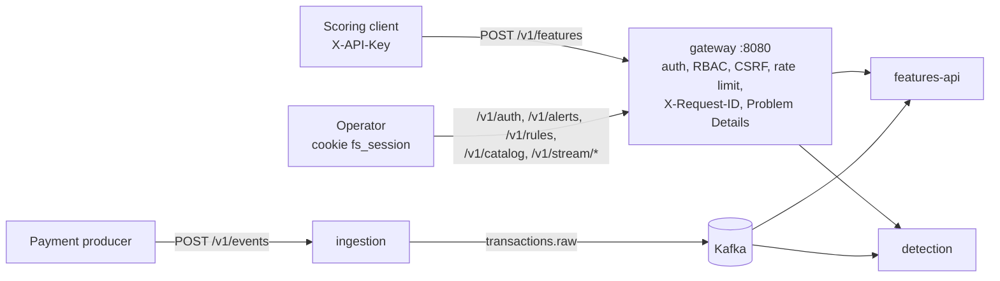

# Criterion: API Documentation

## Architecture Decision Record

### Status

Status: Accepted · Date: 2026-11-24 · Category: **API Documentation**

### Context

The system exposes one public HTTP surface (the gateway, `/v1/*`), three
internal HTTP services behind it (ingestion, features-api, detection), two
Server-Sent Events streams and two Kafka topics. Two kinds of clients integrate:
a machine scoring client (API key) and operators (cookie session, dashboard or
scripts). The contracts are already defined in code: Pydantic models in
`libs/schemas` and in each service. Hand-written specs would drift from them.

### Decision

- **Code-first OpenAPI 3.1.** FastAPI generates the spec from the same Pydantic
  models that validate requests. `make openapi` exports one JSON file per service
  into `docs/openapi/`; CI fails if the committed files differ from a fresh
  export.
- **Examples live next to each service** (`examples.py`, attached with
  `openapi_examples` and response examples), so they are part of the generated
  spec and are checked by contract tests against the real API.
- **AsyncAPI 3.0** for what OpenAPI cannot describe: SSE streams
  (`docs/asyncapi/*-stream.yaml`) and Kafka topics.
- **Linting:** Redocly CLI with a project ruleset (`redocly.yaml`) runs in CI on
  all OpenAPI files; Spectral (`.spectral.yaml`) lints AsyncAPI.
- **Publishing:** a Markdown documentation tree in the repository, plus
  interactive Swagger UI on each service (`/docs`) and one static Redoc page
  for the gateway built in CI.
- **Errors** documented once (Problem Details taxonomy) and referenced from every
  operation.

### Alternatives considered

| Alternative | Pros | Cons | Why not chosen |
| --- | --- | --- | --- |
| Design-first YAML written by hand | Spec reviewed before code | Two sources of truth; drift | The models already are the contract |
| Docusaurus / GitBook site | Polished navigation | Extra build and hosting for a small API | Markdown tree + Redoc is enough; can be added later |
| Postman collection only | Runnable | Not a standard spec; no schema validation | OpenAPI is the reference; `curl` guides are runnable |
| GraphQL / gRPC | Typed schema | Not the shape of this API (resources, cookies, SSE) | REST + SSE |
| Pact contract tests | Consumer-driven | One consumer per API; heavy for this scope | Schema-based contract tests (see below) |

### Consequences

Positive: the reference cannot drift from the code without CI noticing; one
error format to learn. Negative: prose descriptions in Python docstrings are
less pleasant to edit than Markdown. Neutral: internal services publish specs
too, but only the gateway is the supported public surface.

## Documentation structure

```text
docs/
├── guides/                     how-to and onboarding
│   ├── getting-started.md      clean checkout → first authenticated call
│   ├── alert-triage-tutorial.md  operator workflow, step by step
│   ├── best-practices.md       retries, error type, freshness, no PAN
│   └── scripts/                runnable copies of the two guides
├── openapi/                    reference (generated, version-controlled)
│   ├── gateway.json            public API — the one clients use
│   ├── ingestion.json          internal: payment intake
│   ├── features.json           internal: feature lookup
│   └── detection.json          internal: alerts, rules
├── asyncapi/                   streams
│   ├── alerts-stream.yaml
│   └── system-stream.yaml
├── api-errors.md               error taxonomy and recovery
├── api-changelog.md            contract changes by date
├── architecture.md             system context, components, request flows
└── adr/                        decisions behind the API (auth, pagination, SSE…)
```

Reading order for a new developer: [Getting started](../guides/getting-started.md)
→ [Alert triage tutorial](../guides/alert-triage-tutorial.md) → gateway
reference → [errors](../api-errors.md) → [changelog](../api-changelog.md) →
[architecture](../architecture.md). [Best practices](../guides/best-practices.md)
sits beside the tutorial.

## API overview



| Resource | Operations | Auth | Notes |
| --- | --- | --- | --- |
| Auth | `POST /v1/auth/login`, `POST /v1/auth/logout`, `GET /v1/auth/me` | none / session | login rate limit 5/min per IP |
| Features | `POST /v1/features` | API key or session | read via `POST`: token and coordinates stay out of URLs and logs |
| Alerts | `GET /v1/alerts`, `GET /v1/alerts/{id}`, `PATCH /v1/alerts/{id}` | session; `PATCH` analyst/admin + CSRF | keyset pagination; state machine |
| Rules | `GET /v1/rules` | session | rules are data |
| Catalog | `GET /v1/catalog` | session | feature definitions |
| Streams | `GET /v1/stream/alerts`, `GET /v1/stream/system` | session | SSE, AsyncAPI |
| Events (internal) | `POST /v1/events` | network-internal | idempotent by `event_id` |

## Conventions

| Topic | Rule |
| --- | --- |
| Versioning | URL major version `/v1/`. Additive changes (new optional field, new endpoint, new filter) stay in `v1` and are listed in `api-changelog.md`. A breaking change creates `/v2/` and `v1` stays for one release with a `Deprecation` header. |
| Naming | paths: plural nouns, kebab-free lowercase (`/alerts`, `/rules`); JSON fields `snake_case`; enums lowercase strings; ids are UUIDs except external ids (`event_id`, `merchant_id`) |
| Time | RFC 3339 UTC (`2026-11-24T18:01:12.418Z`) |
| Money | integer minor units + ISO 4217 currency (`amount_minor`, `currency`) |
| Errors | Problem Details (`type`, `title`, `status`, `request_id`, `errors[]`); clients switch on `type` |
| Correlation | `X-Request-ID` accepted or generated by the gateway, returned in every response and error |
| Pagination | keyset: `limit` + opaque `cursor` → `next_cursor` (`null` = last page) |
| Examples | every request body and every 2xx/4xx response has a named example; values are realistic and safe (no real PAN; test PANs only in ingestion examples) |
| Files | Markdown, one H1 per file, relative links, Mermaid for diagrams; generated files are never edited by hand |

## Advanced topics

| Topic | Where it is described |
| --- | --- |
| Authentication and authorization (API key, JWT cookie, CSRF, RBAC, token lifetime) | ADR-008, ADR-020, getting-started §4, tutorial §1, §4, §6 |
| Error taxonomy and recovery | `api-errors.md` |
| Pagination | ADR-019, tutorial §2 |
| Rate limits (`100/second` per client, `5/minute` login, `Retry-After`) | `api-errors.md`, tutorial §1 |
| Idempotency (`event_id` at ingestion; gateway retries `GET`, and `POST /v1/features` once on connect failure) | ADR-003, ADR-008, `architecture.md` |
| Feature freshness (`fresh` / `stale` / `fallback` / `default`) | getting-started §5, ADR-013 |
| Live streams (SSE, reconnect, `reset`) | ADR-021, ADR-022, AsyncAPI |
| Request flows and sequence diagrams | `architecture.md`, tutorial |
| Cross-service contracts (Kafka messages, gateway → service headers) | `libs/schemas`, `architecture.md`, AsyncAPI |
| Versioning | [Conventions](#conventions), `api-changelog.md` |

## Requirements checklist (rubric: API Documentation, minimum)

| # | Requirement | Status | Evidence |
| --- | --- | --- | --- |
| 1 | Structured reference: endpoints, parameters, formats, auth, errors | ✅ | `docs/openapi/`, security schemes `ApiKey`, `SessionCookie`, `api-errors.md` |
| 2 | Standard spec, validated, version-controlled | ✅ | OpenAPI 3.1 JSON in Git; job `docs` in [`.github/workflows/ci.yml`](../../.github/workflows/ci.yml) runs `make openapi`, `git diff --exit-code docs/openapi`, then `make docs-lint` |
| 3 | Examples per endpoint: requests, responses, status codes, errors, models | ✅ | named `typical` / `edge` bodies, 2xx examples, shared Problem Details responses; `tests/docs/test_openapi_examples.py` |
| 4 | Getting Started + step-by-step integration tutorial with auth | ✅ | `docs/guides/getting-started.md`, `docs/guides/alert-triage-tutorial.md` |
| 5 | Architecture overview (context, request flow, modules) | ✅ | [API overview](#api-overview), `architecture.md`, tutorial sequence diagram |
| 6 | Developer-accessible format | ✅ | Markdown tree, Swagger UI `/docs`, static Redoc from `make docs-build` (CI artifact `api-docs`, served at `/docs/` when the stage 9 host exists) |
| 7 | Documentation strategy: tools, standards, naming, versioning, formatting, gaps | ✅ | this document |
| 8 | Consistent folder structure | ✅ | [Documentation structure](#documentation-structure) |

Penalty list:

| Category | Status | Note |
| --- | --- | --- |
| Completeness | ✅ | endpoints, named examples, and shared error responses |
| Accuracy | ✅ | gateway `security` matches `rbac_allowed` (`services/gateway/tests/test_api.py`) |
| Structure & navigation | ✅ | reading order and structure above |
| Specification quality | ✅ | `make docs-lint` (Redocly + Spectral) in CI |
| Developer experience | ✅ | guides |
| Examples | ✅ | spec examples plus runnable guide scripts |
| Versioning & updates | ✅ | `/v1/`, `api-changelog.md`, policy above |
| Security documentation | ✅ | auth table, CSRF, RBAC, cookie flags, credential warning |
| Error handling | ✅ | taxonomy with recovery steps |

## Maximum

| Requirement | Status | Evidence |
| --- | --- | --- |
| Conceptual guides, tutorials, onboarding, release notes, versioning | ✅ | guides, [best practices](../guides/best-practices.md), changelog, deprecation policy |
| Advanced topics | ✅ | [Advanced topics](#advanced-topics) |
| Sequence / component diagrams, cross-service contracts | ✅ | tutorial, `architecture.md`, AsyncAPI, `libs/schemas` |
| API linting | ✅ | job `docs`; see the lint result below |
| Contract tests | ✅ | `tests/e2e/test_openapi_contract.py` replays gateway examples; nightly e2e also runs the guide scripts |
| Mock server / sandbox | ✅ | `make docs-mock` — Prism on port 4010 |

## Lint

`make docs-lint` on the committed specs:

```text
Woohoo! Your API descriptions are valid.
9 problems are explicitly ignored.
```

The nine ignores are `operation-4xx-response` on probes (`/health`, `/ready`)
and on detection `GET /v1/rules`, which return only 2xx or 5xx. Spectral
reports warnings on the AsyncAPI files (contact, license, servers) and no errors.

## Known gaps

- SSE payloads are specified in AsyncAPI. OpenAPI documents the stream
  operations as `text/event-stream` plus one example frame.
- Internal services publish specs, but they are not a supported external API.
- The static Redoc page is a CI artifact. The stage 9 host is what will serve
  it at `/docs/` (or GitHub Pages).
