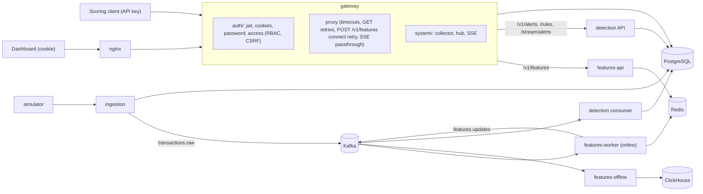
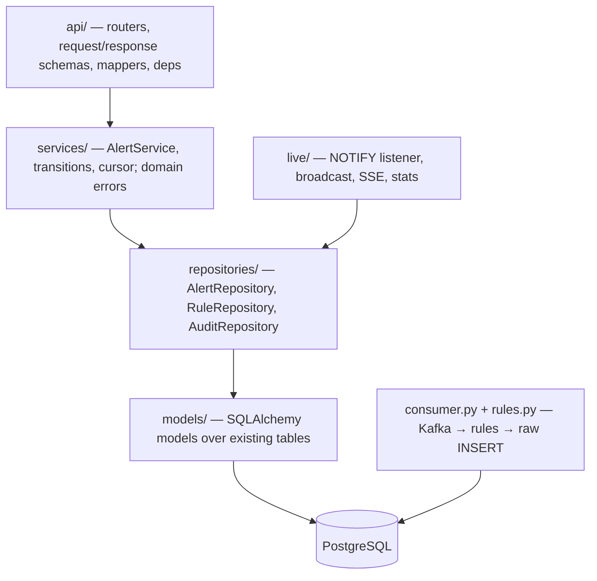

# Criterion: Backend

## Architecture Decision Record

### Status

Status: Accepted · Date: 2026-11-24 · Category: **Backend (Python services)**

### Context

The backend is four FastAPI services and two background workers around one Kafka
log: ingestion (accepts payments, tokenizes PANs, publishes events), features
(online writer, offline writer and Feature API), detection (rules, alerts,
operator CRUD, live stream) and the gateway (single entry point,
authentication, rate limits, system state). Shared contracts live in
`libs/schemas`. Persistence is split by workload: PostgreSQL for relational
state, Redis for online windows, ClickHouse for history. Not every persistence
path is a good fit for an ORM: the online store is Redis with Lua, the offline
store is ClickHouse batch inserts, and the detection consumer collapses
duplicate open alerts with partial unique indexes.

### Decision

- **FastAPI + Pydantic v2** in every HTTP service; configuration only from the
  environment and compose secrets (`settings.py` per service).
- **ORM (SQLAlchemy 2.0 async)** for the CRUD part: detection alerts, rules and
  audit (ADR-019). Models mirror tables created by `infra/postgres/` scripts;
  `create_all` is forbidden, so the database is defined in one place.
- **Layered packages** where the service has CRUD: detection `api/` →
  `services/` → `repositories/` → `models/`, dependencies injected with FastAPI
  `Depends`. Domain errors are raised in `services/` and mapped to HTTP in
  `api/`.
- **No ORM** on hot paths, by design: Redis window updates (Lua, ADR-002 /
  ADR-016 / ADR-017), ClickHouse batches (ADR-018), the detection consumer insert
  (raw SQL + partial unique indexes, ADR-003 / ADR-019), ingestion idempotency
  (one `INSERT … ON CONFLICT` per request).
- **One error format** (Problem Details) in every service (`errors.py`,
  `docs/api-errors.md`); **structured JSON logs** with PAN masking and
  `request_id`.
- **Authentication at the edge** (ADR-008, ADR-020): API key for the scoring
  client, JWT (PyJWT, HS256) in an httpOnly cookie for operators, bcrypt password
  hashes, RBAC per route.

### Alternatives considered

| Alternative | Pros | Cons | Why not chosen |
| --- | --- | --- | --- |
| Django / Django REST | Batteries included, admin | Sync-first; heavy for small services; ORM pushed onto every path | FastAPI: async, Pydantic contracts shared with workers |
| ORM for Redis / ClickHouse | One style | Wrong abstraction; Lua and columnar batches are not row CRUD | Engines dictate access |
| Raw SQL in every FastAPI route | Fewer deps | Fails ORM + layering; transitions hard to test | Detection CRUD moved to layers |
| ORM for consumer inserts | Uniform code | Hides `ON CONFLICT` on a partial unique index | Hot path stays raw SQL |
| Auth in every service | No single point | Duplicated logic, keys spread over services | Edge authentication; services trust only gateway headers |
| Custom token format | No dependency | Forbidden by the rubric; easy to get wrong | PyJWT, standard claims |

### Consequences

Positive: CRUD is testable layer by layer; hot paths keep exact control over
storage semantics; every client sees the same error shape and every log line can
be joined by `request_id`. Negative: two access styles inside detection (ORM API
+ raw consumer) — documented in ADR-019 so the split is intentional. Neutral:
services trust `X-Operator-*` headers from the gateway, so their ports must not
be reachable from outside in production (see [Known gaps](#known-gaps)).

## Architecture

Layers in detection (the CRUD service):

| Service | Responsibility | Entry points |
| --- | --- | --- |
| ingestion | validate payment, tokenize PAN (HMAC, ADR-009), idempotent accept, publish | `POST /v1/events` |
| features-worker | apply events to Redis windows, publish snapshots | Kafka consumer |
| features-offline | batch events and snapshots into ClickHouse | Kafka consumer |
| features-api | serve feature values with freshness status | `POST /v1/features` |
| detection | rules over snapshots, alert lifecycle, audit, live stream | Kafka consumer, `/v1/alerts`, `/v1/rules`, `/v1/stream/alerts` |
| gateway | single entry point, auth, RBAC, rate limit, system state | `/v1/*`, `/v1/auth/*`, `/v1/stream/system` |

## Design principles (SOLID)

| Principle | Where it shows |
| --- | --- |
| Single Responsibility | detection routers only translate HTTP ↔ service calls; `AlertService` owns transitions and permissions; repositories own queries. Gateway auth is split into `jwt.py`, `cookies.py`, `password.py`, `access.py`. Ingestion separates `tokenize.py`, `idempotency.py`, `publisher.py`. |
| Open/Closed | alert rules are data (`detection.alert_rules` + `rule_features`): a new rule is a row, not code (`rules.py` evaluates any clause set). Features are declared in the catalog (ADR-012); windows and API read the catalog instead of hard-coding names. New error types are added to the Problem Details map without touching handlers. |
| Liskov Substitution | no deep inheritance in the domain; where subtypes exist they are drop-in: ORM models share one `Base`; domain errors (`AlertNotFoundError`, `InvalidTransitionError`, …) are plain exceptions mapped uniformly; tests replace HTTP upstreams with httpx `MockTransport` and Redis with fakeredis without changing calling code. |
| Interface Segregation | three small repositories (`AlertRepository`, `RuleRepository`, `AuditRepository`) instead of one DAO; `AuthContext` exposes only what route checks need; contracts in `libs/schemas` are per message (`TransactionEvent`, `FeatureSnapshot`, `FeatureRequest`). |
| Dependency Inversion | routers depend on `AlertService` provided by `Depends(provide_alert_service)`; the service receives repositories bound to a session; settings, clocks, HTTP clients and Kafka producers are injected, which is what makes the unit tests run without infrastructure. |

## Requirements checklist (rubric: Backend, minimum)

| # | Requirement | Status | Evidence |
| --- | --- | --- | --- |
| 1 | Modern framework | ✅ | FastAPI in ingestion, features-api, detection, gateway |
| 2 | Database for state | ✅ | PostgreSQL (OLTP), Redis (online), ClickHouse (offline) — `docs/criteria/database.md` |
| 3 | ORM | ✅ | SQLAlchemy 2.0 async in detection CRUD (ADR-019); hot paths without ORM are justified above |
| 4 | Layered architecture | ✅ | `detection/api`, `services`, `repositories`, `models` |
| 5 | SOLID | ✅ | [Design principles](#design-principles-solid) |
| 6 | API description | ✅ | `docs/openapi/*.json` (generated by `make openapi`), `docs/asyncapi/*.yaml`, `docs/api-errors.md`, `docs/api-changelog.md` |
| 7 | Global error handling | ✅ | `errors.py` in every service: `HTTPException`, `RequestValidationError`, `Exception` → Problem Details with `request_id`; unexpected errors logged with stack, PAN masked |
| 8 | Structured logging | ✅ | one JSON object per line, PAN masking filter, `request_id` / `event_id` fields (`ingestion/logging.py`, `gateway/logging.py`, workers) |
| 9 | Production deployment, accessible to external users | ⚠️ | planned: one EC2 instance with the compose stack behind TLS (stage 9); until then the stand runs locally with `make up` |
| 10 | Unit-test coverage ≥ 70% | ✅ | 75.4% lines, gate `--cov-fail-under=70` — `docs/criteria/automated-testing.md` |

Constraints:

| Constraint | Status | Evidence |
| --- | --- | --- |
| No paid libraries | ✅ | open-source stack only (`uv.lock`) |
| Avoid vulnerable packages | ✅ | `make audit` / CI `uvx pip-audit` on `uv export --frozen` |
| Version control | ✅ | Git history, one PR per task |
| JSON as data format | ✅ | all HTTP bodies, Kafka messages, SSE payloads |
| No secrets in the repository | ✅ | passwords and keys from environment and compose secrets (`make secret`, `infra/.env.example`); only local demo values for the seed |
| Deployable from the repository | ✅ | `make secret up topics` on a clean checkout; images built from Dockerfiles in the repo |
| No custom crypto / custom JWT | ✅ | HMAC-SHA-256 (stdlib `hmac`), bcrypt, PyJWT |
| No educational-only servers | ✅ | uvicorn |
| No stubs instead of a real API | ✅ | every endpoint reads or writes real stores; the SQL baseline is a measurement stand, not a product API (ADR-015) |
| Modularity | ✅ | services, `libs/schemas`, packages per concern |

Common mistakes (penalty list):

| Item | Status | How it is avoided |
| --- | --- | --- |
| Insecure hashing | ✅ | bcrypt for passwords, HMAC-SHA-256 for PAN tokens |
| Sensitive data in plain text | ✅ | PAN never stored (PAN scanner over all stores in CI e2e), password hashes only, JWT in httpOnly cookie |
| Missing input validation | ✅ | Pydantic models with `extra="forbid"`, Luhn and range checks, parametrized SQL / ORM only |
| Missing error handling, wrong status codes | ✅ | 401, 403, 404, 409, 422, 429, 503, 504 used as documented in OpenAPI and `docs/api-errors.md` |
| Database inconsistency | ✅ | ORM models mirror DDL; integration tests run against the real init scripts |
| Missing API documentation | ✅ | see row 6 above |
| Inefficient queries | ✅ | keyset pagination with matching indexes (`40-alerts-ui.sql`), `selectinload` only where the detail view needs relations, Redis reads in one Lua call (ADR-016) |
| Hardcoded configuration | ✅ | `Settings` from environment in every service |
| Magic strings | ⚠️ | role names `viewer` / `analyst` / `admin` are repeated as literals in a few gateway checks — to be replaced by one `OperatorRole` constant set |
| Code duplication | ⚠️ | the JSON log formatter is copied in several services — to be extracted into one shared module |
| Not following REST | ✅ | resources and verbs: `GET`/`PATCH /alerts/{id}`, `GET /rules`. `POST /v1/features` is a read: the body carries a card token and coordinates that must not appear in URLs, access logs or browser history; documented in OpenAPI |

## Maximum

| Requirement | Status | Evidence |
| --- | --- | --- |
| Microservice architecture, independently deployable | ✅ | six images, one compose service each — `docs/criteria/microservices.md` |
| Asynchronous communication | ✅ | Kafka topics `transactions.raw`, `features.updates`; independent consumer groups (ADR-001) |
| Caching | ✅ | Redis as the online store of precomputed window aggregates; catalog cached in services |
| System monitoring | ⚠️ | Prometheus scrapes all services (ADR-014); Grafana dashboards not yet |
| Request tracing (correlation id) | ✅ | `X-Request-ID` created or accepted at the gateway, forwarded upstream, present in every log line and error body |
| Log management system | ❌ | logs are structured JSON on stdout; no Loki / ELK |
| Alerting system | ❌ | no Alertmanager |
| CI/CD: image → registry → deploy | ⚠️ | CI builds and tests images; no registry push and no automated deploy yet |
| Quality gates | ⚠️ | ruff, mypy, tests, 70% coverage gate, `pip-audit`, `npm audit` in CI; no SonarQube, gate below 80% |

## Implementation

- Services: `services/ingestion`, `services/features`, `services/detection`,
  `services/gateway`; shared contracts: `libs/schemas`
- Error handling: `services/*/src/*/errors.py`, taxonomy in `docs/api-errors.md`
- Auth: `services/gateway/src/gateway/auth/` (ADR-020)
- ORM: `services/detection/src/detection/models/`, `repositories/` (ADR-019)
- OpenAPI export: `make openapi` → `docs/openapi/`
- CI: `.github/workflows/ci.yml` (lint, types, audit, unit, integration),
  `e2e.yml` (nightly full stack)

## Known gaps

- **Production deployment** is not live yet; planned as one EC2 instance with a
  prod compose override (only 80/443 public), TLS and secrets outside the
  repository.
- **Internal ports are published to the host** in the local compose file.
  Detection, features-api and ingestion trust headers set by the gateway, so in
  production only the gateway (behind nginx) may be reachable. The prod override
  removes the other `ports:` entries.
- **Duplicated JSON log formatter and repeated role literals** — small
  refactors listed in the penalty table above.
- **Maximum-level observability** (Grafana dashboards, Loki, Alertmanager) and
  full CD are not implemented.
