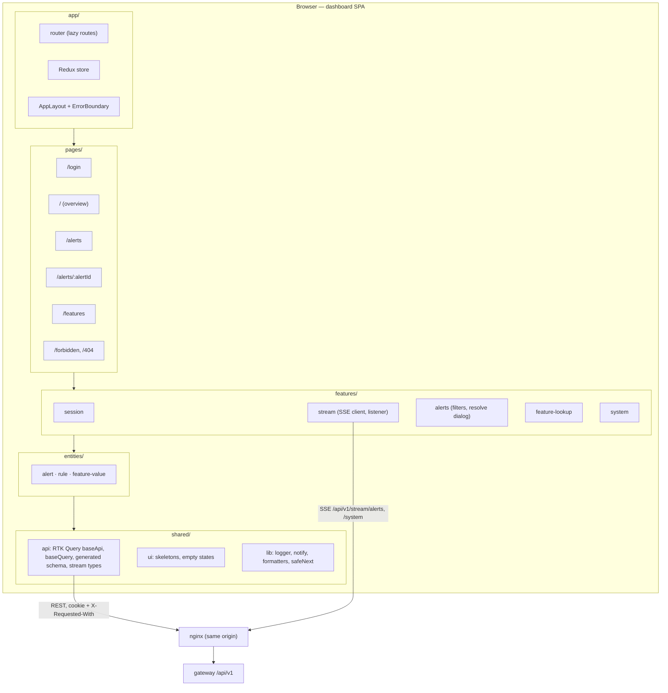
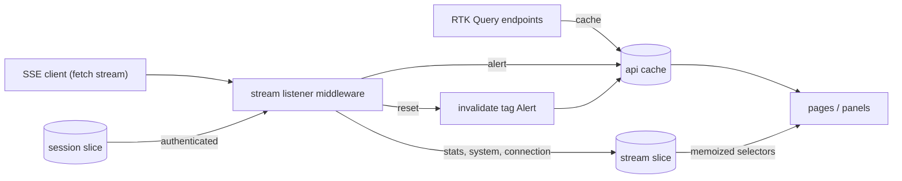
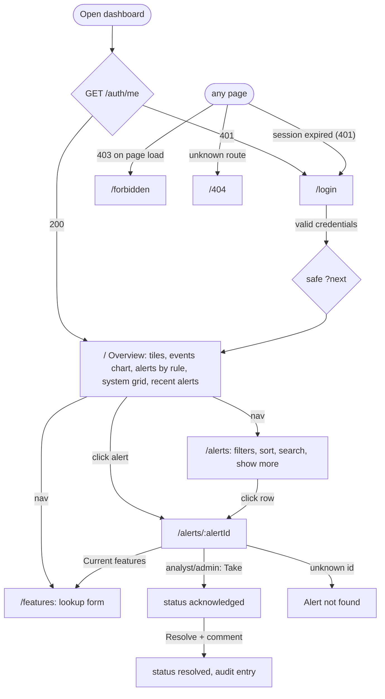

# Criterion: Frontend

## Architecture Decision Record

### Status

Status: Accepted · Date: 2026-11-24 · Category: **Frontend (operator dashboard SPA)**

### Context

Fraud operators need one screen to watch the payment stream, react to alerts and
inspect the feature values a model would see for a card or merchant. The data is
live: alerts and stream statistics arrive continuously over SSE (ADR-021), system
state changes are pushed (ADR-022), and every action is tied to an authenticated
operator with a role (ADR-020). The client therefore has to combine server state
(REST), push state (two SSE channels) and session state, keep them consistent
(an alert changed by another operator must update every open view), and degrade
visibly when the stream drops. It must work on a phone as well as on a desk.

### Decision

- **SPA on React 18 + TypeScript (strict) + Vite**, served by nginx on the same
  origin as the API (`/api/` → gateway). No CORS; the session is an httpOnly
  cookie, so the bundle holds no token or key.
- **Feature-sliced structure** (`app → pages → features → entities → shared`),
  enforced by ESLint `no-restricted-imports` rules: a layer imports only downward.
- **Redux Toolkit** for client state (`session`, `stream`, `featureLookup`
  slices, memoized selectors) and **RTK Query** for server state, one store and
  one cache. Push events are written into the RTK Query cache
  (`updateQueryData`), so REST and SSE never disagree.
- **Typed API** generated from `docs/openapi/gateway.json`
  (`openapi-typescript`); CI fails if the generated file is stale. SSE payloads
  are validated at runtime with zod.
- **Mantine** as the UI kit (layout, forms, notifications, charts on Recharts),
  with a project theme, light and dark schemes.
- Live data only by push. REST is used for the initial load and for operator
  actions; nothing on screen refreshes by client polling.

### Alternatives considered

| Alternative | Pros | Cons | Why not chosen |
| --- | --- | --- | --- |
| TanStack Query + Zustand | Lightweight, popular | Two libraries for server and client state; SSE writes go to two places | One Redux store + RTK Query cache keeps push and REST consistent |
| Next.js (SSR) | SEO, server rendering | Operator tool behind login, no SEO need; extra server runtime | Static SPA behind nginx is enough |
| Native `EventSource` | Built-in reconnect | `: ping` comments are invisible to JS (no staleness signal); no control over backoff after HTTP errors | `fetch` stream with own parser and backoff (`sseClient.ts`) |
| WebSocket | Bidirectional | Data flows one way; needs its own reconnect and resume protocol | SSE gives `Last-Event-ID` resume over plain HTTP (ADR-021) |
| Token in `localStorage` | Simple | Readable by any injected script; violates "no tokens in code/storage" | httpOnly cookie + `X-Requested-With` CSRF header (ADR-020) |
| MUI / custom kit | Large ecosystem / full control | MUI heavier to theme; custom kit costs time | Mantine: accessible components, dark scheme and charts out of the box |

### Consequences

Positive: one source of truth for every alert on screen; the UI shows when data
is stale instead of showing old numbers as current; layer rules keep features
independent and testable. Negative: a hand-written SSE client is more code than
`EventSource` — covered by unit tests for parsing, backoff and reconnect.
Neutral: the bundle depends on the gateway OpenAPI file, so API changes require
`npm run gen:api`.

## Architecture



State and data flow:



| Piece | File |
| --- | --- |
| Routes, lazy loading, guards | `dashboard/src/app/router.tsx`, `features/session/ui/RequireAuth.tsx` |
| Store | `dashboard/src/app/store.ts` |
| API layer, error handling | `dashboard/src/shared/api/baseApi.ts`, `baseQuery.ts`, `problem.ts` |
| Generated API types | `dashboard/src/shared/api/schema.d.ts` (`npm run gen:api`) |
| SSE client and reconnect | `features/stream/model/sseClient.ts`, `parseSse.ts`, `reconnectDelay.ts` |
| Push → cache | `features/stream/model/streamListener.ts`, `alertCache.ts` |
| Layer rules | `dashboard/eslint.config.js` |
| Container | `dashboard/Dockerfile`, `dashboard/nginx.conf` |

## Approach

- **Session.** On start the app calls `GET /auth/me`; until it answers, a
  skeleton is shown. The store keeps only `operator_id`, `email`, `role`.
  `RequireAuth` and `RequireGuest` guard routes; `selectCanChangeAlerts` hides
  actions from `viewer`, and the server still enforces roles (403 is handled).
- **Live stream.** One connection per channel for the whole app, opened by a
  listener when the session becomes authenticated and closed on logout. Transport
  drops reconnect after the server `retry`; HTTP errors first re-check the
  session (401 → login), then back off 1 → 2 → 4 … 30 s with jitter.
  `Last-Event-ID` is sent on resume; `reset` invalidates the alert cache.
- **Staleness.** A channel is stale if it is not `open` for 3 s or if nothing,
  including `: ping`, arrived for 20 s. A banner ("Data is not updating since …")
  appears on every page with `role="status"`; live panels are dimmed, not hidden.
- **Consistency.** Status changes use optimistic updates with rollback; 409
  re-reads the alert. Alert events from the stream patch the list and the detail
  cache, so a change by another operator shows up in every open tab.
- **Lists.** New alerts that match the filter are collected behind a
  "N new — show" bar instead of shifting rows under the cursor.
- **URL as state.** Alert filters and lookup parameters live in the query string:
  links are shareable and Back works.

## API used by the client

All calls go to `/api/v1` on the same origin with `credentials: include`. Every
non-GET request carries `X-Requested-With: fetch` (CSRF guard, ADR-020).
Errors follow Problem Details (`docs/api-errors.md`).

| Method and path | Used by | Notes |
| --- | --- | --- |
| `POST /auth/login`, `POST /auth/logout`, `GET /auth/me` | session | cookie `fs_session` |
| `GET /alerts` | alerts list, overview | filters, sort, keyset `cursor` |
| `GET /alerts/{alert_id}` | alert detail | rule conditions + audit history |
| `PATCH /alerts/{alert_id}` | alert detail | `acknowledged` / `resolved` + `note` |
| `GET /rules` | filters, labels | |
| `GET /catalog` | feature lookup | names, windows, stale thresholds |
| `POST /features` | feature lookup | same contract as the scoring client |
| `GET /stream/alerts` (SSE) | stream | events `alert`, `stats`, `reset` (`docs/asyncapi/alerts-stream.yaml`) |
| `GET /stream/system` (SSE) | system grid | events `snapshot`, `change` (`docs/asyncapi/system-stream.yaml`) |

Examples:

```http
POST /api/v1/auth/login
Content-Type: application/json
X-Requested-With: fetch

{"email": "analyst@featurestore.local", "password": "…"}
→ 204 No Content, Set-Cookie: fs_session=…; HttpOnly; SameSite=Strict; Path=/api
```

```http
GET /api/v1/alerts?status=open&entity_type=card&sort=-created_at&limit=50
→ 200 {"items": [{"alert_id": "…", "rule_id": "…", "status": "open", "card_token": "…", "created_at": "…"}], "next_cursor": "eyJ…"}
```

```http
PATCH /api/v1/alerts/6f1c…
Content-Type: application/json
X-Requested-With: fetch

{"status": "resolved", "note": "False positive: test card"}
→ 200 AlertOut · 403 viewer · 409 already changed · 422 note missing
```

```http
POST /api/v1/features
Content-Type: application/json
X-Requested-With: fetch

{"card_token": "<64 hex>", "ts": "2026-11-24T16:00:00Z"}
→ 200 {"request_id": "…", "features": {"card_cnt_1m": {"value": 7, "status": "fresh", "as_of": "…", "age_ms": 180}, …}}
```

```text
GET /api/v1/stream/alerts
retry: 3000

id: 418
event: alert
data: {"op": "created", "alert_id": "…", "rule_name": "card_velocity_burst", "status": "open", "entity": "card", "entity_id": "ab12…ef", …}

event: stats
data: {"events_per_s": 49.0, …}

: ping
```

## User flows and navigation



Main operator scenario: an alert arrives on the overview without reload → open
it → see which rule condition fired against which feature value → take it →
resolve with an outcome and a comment → the history shows both steps, and other
open tabs update by themselves.

Navigation: sidebar on tablet and desktop (collapsed below `lg`), bottom tab bar
on phones; "Skip to content" is the first Tab stop.

## Technology stack

| Concern | Choice | Why |
| --- | --- | --- |
| Framework | React 18, TypeScript `strict`, Vite | standard SPA stack; fast builds; strict types catch contract drift |
| Routing | React Router 6, `React.lazy` per page | code splitting by route from the start |
| State | Redux Toolkit (slices, `createSelector`, listener middleware) | push events, session and server cache in one store |
| Server state | RTK Query | tag invalidation, optimistic updates, `updateQueryData` for SSE |
| API types | `openapi-typescript` from gateway OpenAPI | one contract for backend and frontend |
| Runtime validation | zod | SSE payloads and forms |
| Forms | react-hook-form + zod resolver | field-level errors, server 422 mapped to fields |
| UI | Mantine 7 (+ Charts, Notifications), Tabler icons | accessible components, dark scheme, responsive grid |
| Tests | Vitest, Testing Library, MSW, Playwright, axe-core | unit/component with mocked API; e2e against the compose stand |
| Quality | ESLint (typescript-eslint strict, react-hooks, jsx-a11y, layer rules), Prettier | enforced in CI |
| Serving | nginx (non-root), same-origin proxy, SSE without buffering, CSP | no CORS, cookie auth, security headers |

## Error handling

Handled once in `baseQueryWithErrors` (`shared/api/baseQuery.ts`); messages are
chosen by Problem Details `type` (`shared/lib/errorMessages.ts`).

| Response | Reaction |
| --- | --- |
| 401 | session reset, redirect to `/login?next=<path>`; on login itself — form error |
| 403 | toast "Insufficient permissions"; on page load — `/forbidden` |
| 404 | "Alert not found" screen with a link back to the list |
| 409 | toast "Status was already changed", alert re-fetched |
| 422 | `errors[]` shown under form fields |
| 429 | toast with time from `Retry-After` |
| 5xx, network | toast "Service unavailable" with `request_id`; GET retried up to 2 times |

Rendering errors: a global `ErrorBoundary` plus one per page, so a failing panel
does not take down navigation. Every async view has a skeleton and an empty
state. The logger (`shared/lib/logger.ts`) keeps only `warn`/`error` in
production and never logs tokens or alert payloads.

## Testing

- Unit and component: 28 files, 72 tests (Vitest + Testing Library + MSW);
  line coverage 81% with a 70% threshold (`vite.config.ts`). Covered: session and
  stream slices and selectors, `baseQuery` reactions, SSE parsing, backoff and
  reconnect, push → cache, forms (login, resolve, lookup), formatters, `safeNext`.
- e2e (Playwright against the compose stand, nightly `e2e.yml`):
  `analyst.spec.ts` — burst alert appears without reload, take, resolve with a
  comment; `viewer.spec.ts` — no actions for viewer, stale banner on paused
  gateway and recovery; `a11y.spec.ts` — axe-core, no serious or critical
  violations on login, overview, alerts, features.
- CI job `dashboard` (`.github/workflows/ci.yml`): lint → Prettier → typecheck →
  generated types are current → tests with coverage → build → `npm audit` →
  image build.

## Requirements checklist (rubric: Frontend, minimum)

| # | Requirement | Status | Evidence |
| --- | --- | --- | --- |
| 1 | Architecture diagram (modules, components, routing, state) | ✅ | [Architecture](#architecture) |
| 2 | Approach description | ✅ | [Approach](#approach) |
| 3 | API documentation used by the client | ✅ | [API used by the client](#api-used-by-the-client), `docs/openapi/gateway.json`, `docs/asyncapi/` |
| 4 | User flow / navigation diagram | ✅ | [User flows and navigation](#user-flows-and-navigation) |
| 5 | Technology stack justification | ✅ | [Technology stack](#technology-stack), ADR above |
| 6 | Modern framework, SPA | ✅ | React 18 + Vite |
| 7 | Components / pages / hooks / services separated | ✅ | feature-sliced layers, enforced by ESLint |
| 8 | Routing, 3–4+ routes | ✅ | 5 protected routes + `/login`, `/forbidden`, `/404` |
| 9 | Local and global state | ✅ | Redux slices + component state (forms, dialogs) |
| 10 | Typed API, centralized request layer | ✅ | generated `schema.d.ts`, single `baseApi` / `baseQuery` |
| 11 | Error and loading states for requests | ✅ | `baseQuery`, skeletons, empty states |
| 12 | Reusable and layout components, UI library | ✅ | `shared/ui`, `AppLayout`, Mantine theme |
| 13 | Forms with validation | ✅ | login, resolve dialog, feature lookup (zod) |
| 14 | Tables / lists | ✅ | alerts table and cards, feature table |
| 15 | Filter / search / sort | ✅ | status, rule, entity type, period, sort, search |
| 16 | Responsive: desktop + mobile | ✅ | 360 / 768 / 1280 px, bottom tabs on phones |
| 17 | ESLint + Prettier | ✅ | `eslint.config.js`, CI |
| 18 | Basic logging | ✅ | `shared/lib/logger.ts` |
| 19 | Global error handler / interceptor, user messages | ✅ | `baseQueryWithErrors`, notifications |
| 20 | 401 / 403 / 404 / 500 handled | ✅ | [Error handling](#error-handling) |
| 21 | Loading indicators for async operations | ✅ | page and panel skeletons |
| 22 | Unit tests for 3+ components or services | ✅ | 72 tests |
| 23 | 1–2 e2e tests | ✅ | `analyst.spec.ts`, `viewer.spec.ts` (+ `a11y.spec.ts`) |
| — | No inline styles without reason | ✅ | 0 `style={{…}}` in `src/` (CSS modules + theme tokens) |
| — | No single component for the whole app | ✅ | feature-sliced |
| — | No `any` without justification | ✅ | `@typescript-eslint/no-explicit-any: error` |
| — | No tokens or passwords in code | ✅ | httpOnly cookie; demo passwords exist only in the local seed and dashboard README |

## Maximum: chosen directions

| Direction | Evidence |
| --- | --- |
| **Advanced State Management** | Redux Toolkit slices `session`, `stream`, `featureLookup`; memoized selectors (`streamSelectors.ts`); listener middleware that owns the SSE lifecycle; push events written into the RTK Query cache; optimistic updates with rollback |
| **Advanced UI/UX** | live charts and tiles (Mantine Charts); light/dark scheme following `prefers-color-scheme` with a toggle; WCAG 2.1 AA checklist with measured contrast ratios (`dashboard/reports/wcag.md`), skip link, keyboard paths, chart summaries for screen readers, `prefers-reduced-motion`; axe-core in e2e |
| **Advanced Architecture** | feature-sliced design with import direction enforced by lint; lazy routes; API types generated from OpenAPI and checked in CI |

Not claimed: Performance direction. Lazy routes and `memo` on the overview
panels exist, but no Lighthouse report, bundle analysis or Web Workers.

## Known limitations

- Session tokens cannot be revoked before expiry (stateless JWT, ADR-020); logout
  clears the cookie only.
- Stream statistics come from one detection process; with several replicas each
  sees only its partitions (ADR-021).
- `fallback` feature status and degraded read mode are shown by the UI but are
  produced only after stage 5 (degradation).
- No i18n: interface text is English.
