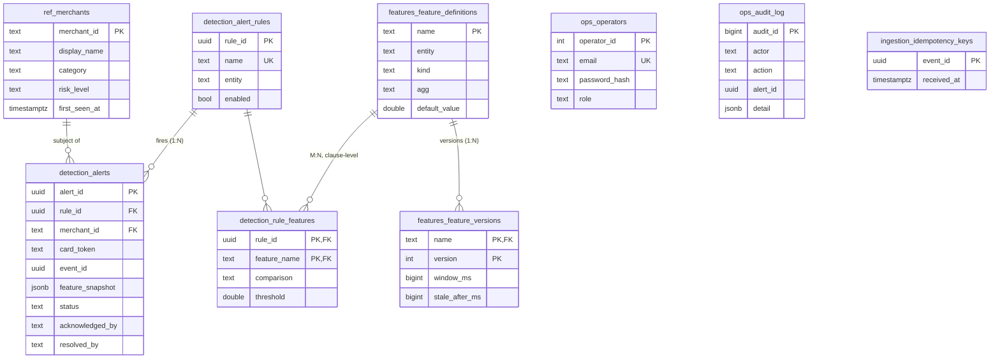

# Database: data dictionary and design notes

DBMS: **PostgreSQL 17** — the transactional (OLTP) part of the system. The online
feature store is Redis (ADR-002) and the offline store is ClickHouse (ADR-004);
why three engines coexist is argued in `docs/criteria/database.md`.

Structure is created exclusively by the scripts in
[`infra/postgres/`](../../infra/postgres/) — `00-roles.sh` (roles; passwords from
the environment, nothing in Git) → `10-schema.sql` → `20-seed.sql` →
`30-baseline.sql` — mounted into `/docker-entrypoint-initdb.d` and executed once
when the Postgres volume is created. No objects are created by hand.
`30-baseline.sql` is the measurement stand, not a product schema (ADR-015).

## Schemas (one per bounded context)

| Schema | Written by | Purpose |
| --- | --- | --- |
| `ingestion` | ingestion | Idempotency keys for exactly-once event acceptance (ADR-003) |
| `ref` | detection (registry upsert), seed | Merchants seen by the pipeline + demo attributes |
| `features` | features api | Feature registry, materialized from the catalog in code (ADR-012) |
| `detection` | detection | Alert rules, clause links, alerts |
| `ops` | trigger (audit), seed | Operators, audit trail |
| `baseline` | baseline writer | Стенд для замеров, не часть продукта (ADR-015) |

Each service connects under its own account (`svc_*`) and writes only to its own
schema; everything else is `SELECT` at most. The application never connects as the
container owner or a superuser.

## ER diagram

Relationship types: 1:N (`feature_definitions → feature_versions`,
`alert_rules → alerts`, `merchants → alerts`) and M:N
(`alert_rules ↔ feature_definitions` through `rule_features`, which carries the
comparison and threshold per clause — a rule fires only when **all** its clauses
hold).

## Tables

### baseline.transactions

Стенд для замеров, не часть продукта (ADR-015). One row per delivered event.
`event_id` is the primary key, so a replay collapses in
`INSERT … ON CONFLICT DO NOTHING`. The stand keeps every column the feature
queries need and nothing else: no `payment_id`, no retention, no partitioning.
Indexes `(card_token, event_time DESC)` and `(merchant_id, event_time DESC)`
serve the card window and the merchant window. `svc_baseline` is the only
login granted on this schema and is not a member of `fs_read` or `fs_write`.

### ingestion.idempotency_keys

24 h exactly-once acceptance window (ADR-000/003). Written by
`INSERT … ON CONFLICT` in the ingestion accept path; rows older than 25 h are
removed by `ingestion.delete_expired_idempotency_keys()`, called on a timer by the
service (granted `EXECUTE` only).

### ref.merchants

The simulator population draws ids `m0…mN` (5,000 by default), so merchants is a
**registry of subjects seen by the pipeline**: detection upserts the bare id on
first sight (`first_seen_at`, `risk_level = 'unclassified'`); descriptive
attributes are nullable and the seed fills them for known merchants —
reference-table fill demo. Rows are never deleted.

### features.feature_definitions / feature_versions

Read model of the catalog in code — **code is the source of truth** (ADR-012); the
features api upserts both tables at startup, version history accumulates in
`feature_versions` (PK `(name, version)`). `entity`, `kind`, `agg` are
CHECK-constrained to the catalog vocabulary; `window_ms`/`stale_after_ms` are
`CHECK (> 0)` and NULL for on-demand features. Rules join by `name`; the gateway
serves `/v1/catalog` from these two tables with a single SELECT.

### detection.alert_rules / rule_features

`alert_rules` holds the rule identity (`rule_id uuid`, unique `name`, `entity`,
`enabled`); every comparison lives in `rule_features`
(`comparison ∈ {gt, ge, lt, le}` × `threshold`). Detection reloads enabled rules
every 60 s; rules referencing on-demand features are skipped — snapshots carry
stream features only (ADR-013).

### detection.alerts

| Column | Type / constraint | Notes |
| --- | --- | --- |
| alert_id | uuid PK, `gen_random_uuid()` | |
| rule_id | FK → alert_rules | |
| merchant_id / card_token | FK → merchants / text; **XOR CHECK** — exactly one subject | `card_token` is an HMAC token (ADR-009): raw PANs never reach the database |
| event_id | uuid NOT NULL | Pipeline correlation id of the triggering event |
| feature_snapshot | jsonb NOT NULL | Justified below |
| status | CHECK open/acknowledged/resolved | `resolved ⇔ resolved_at IS NOT NULL` (CHECK) |
| acknowledged_by/at, resolved_by/at | text / timestamptz | Set by the alert API together with the status |

**Integrity in the schema, not in code:** two partial unique indexes guarantee at
most one *open* alert per (rule, card) and per (rule, merchant) — duplicate
inserts under Kafka at-least-once redelivery or concurrent consumers collapse at
the database level. A third index `(rule_id, created_at DESC)` serves history
reads.

**jsonb justification** (the rubric requires one for unstructured data in a
relational model): `feature_snapshot` is a write-once, point-in-time copy of the
clause values that fired the rule, kept for operator context and audit. Its shape
varies per rule, it is never filtered or joined by its internals, and the
authoritative structured form of the same values lives in the feature stores.
Normalizing it would add a table no query needs.

### ops.operators / ops.audit_log

Operator passwords exist **only** as bcrypt hashes (pgcrypto `crypt`); a CHECK on
the hash format makes plain-text inserts impossible. `ops.operators_masked` masks
emails for non-admin consumers (the only operator view granted to the gateway —
data masking). `audit_log` receives a row on every alert status transition from a
`SECURITY DEFINER` trigger: it runs as the schema owner, so no service holds a
write grant on the audit table — the trail cannot be forged or skipped by a
service account.

## Integrity and transactions

- Every relationship is a declared FK; every enum-like column is
  CHECK-constrained; all timestamps are `timestamptz`; event amounts stay in
  minor units end to end (`amount_minor` in events).
- Ingestion accept path: idempotency insert + Kafka publish coordinated so a
  duplicate `event_id` is acknowledged without re-publishing (ADR-003).
- Detection applies each snapshot in a single transaction (merchant upsert +
  alert inserts); status transitions take `SELECT … FOR UPDATE` on the row, and
  the audit record is written by the trigger in the same transaction.

## Schema versioning

DDL and seed are versioned in Git next to the code; changes arrive only through
reviewed pull requests, and `make clean && make up` rebuilds the database
deterministically. After the first release, changes continue as numbered scripts
in the same directory (`NN-description.sql`, lexicographic order) — same
mechanism, explicit history.

## Roles and access

| Account | Rights |
| --- | --- |
| fs_read / fs_write / fs_admin | Group tiers (NOLOGIN); svc accounts are members |
| svc_ingestion | `ingestion`: insert/select/delete idempotency keys, execute cleanup |
| svc_features | `features`: write registry |
| svc_detection | `detection`: write alerts, read rules; `features`: read; `ref`: read + insert (registry upsert) |
| svc_gateway | read-only: open_alerts_v, alerts, alert_rules, merchants, feature registry, **operators_masked** (not operators) |
| svc_baseline | `baseline.transactions`: select, insert. No other schema. Not a member of `fs_read` or `fs_write`. Measurement stand, not part of the product (ADR-015) |
| container owner | schema owner — init/migrations only, never used by services |

Role passwords come from the environment (`infra/.env`, from `.env.example`);
nothing is committed — per the submission rules.
