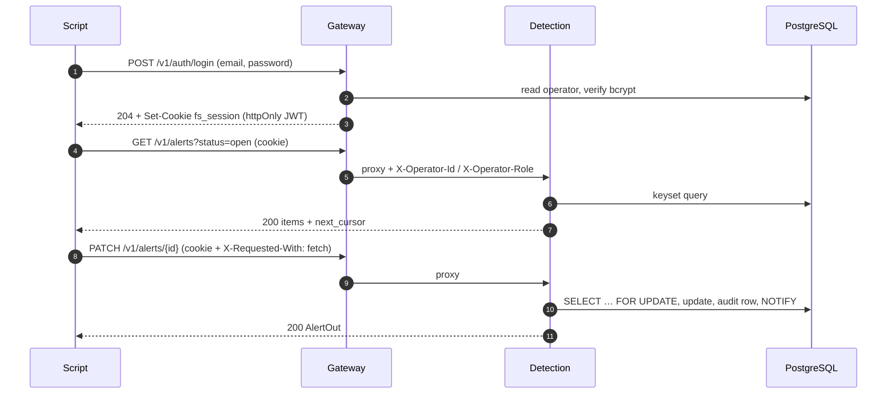
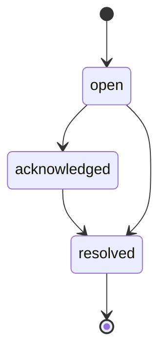

# Tutorial: triage an alert from a script

This tutorial builds a small operator workflow on top of the gateway API:
log in, find open alerts, inspect one, acknowledge it, resolve it with a note
and log out. The dashboard does exactly the same calls.

- Prerequisite: [Getting started](getting-started.md) steps 1–3 (stack running,
  traffic flowing).
- Time: 15 minutes.
- You will learn: cookie sessions and CSRF, RBAC, keyset pagination, the alert
  state machine, and how to handle each error.



Set a base URL once:

```bash
export API=http://localhost:8080
```

## Step 1. Log in

```bash
curl -s -c cookies.txt -o /dev/null -w '%{http_code}\n' "$API/v1/auth/login" \
  -H 'Content-Type: application/json' \
  -d '{"email":"analyst@featurestore.local","password":"demo-analyst-pass"}'
```

| Result | Meaning |
| --- | --- |
| `204` | Session cookie `fs_session` is in `cookies.txt` |
| `401 unauthorized` | Wrong email or password (the response does not say which) |
| `422 validation_error` | Body is not `{email, password}` |
| `429 rate_limited` | More than 5 attempts per minute from your IP; wait `Retry-After` seconds |

The cookie is `HttpOnly` and `SameSite=Strict`; a browser script cannot read
it. A session lasts one hour (cookie `Max-Age` and JWT `exp`); after that calls
return `401` and you log in again.

## Step 2. Find open alerts

```bash
curl -s -b cookies.txt "$API/v1/alerts?status=open&sort=-created_at&limit=20" | jq
```

```json
{
  "items": [
    {
      "alert_id": "6a4e2f0c-1d8b-4a37-9b9e-2c7f5e1a0b44",
      "rule_id": "1f0a9c3e-7b2d-4e5f-8a6b-3c4d5e6f7a8b",
      "status": "open",
      "merchant_id": null,
      "card_token": "9c1f…e07a",
      "event_id": "evt-000184233",
      "feature_snapshot": { "card_cnt_1m": 12 },
      "created_at": "2026-11-24T18:01:12.418Z",
      "acknowledged_at": null,
      "acknowledged_by": null,
      "resolved_at": null,
      "resolved_by": null,
      "resolution_note": null
    }
  ],
  "next_cursor": "eyJjIjoiMjAyNi0xMS0yNFQxODowMToxMi40MThaIiwiaSI6IjZhNGUifQ"
}
```

Filters: `status` (repeatable), `entity_type=card|merchant`, `entity` (exact
id), `rule_id`, `created_from`, `created_to`. `limit` is 1–1000, default 100.

### Pagination

Pages are keyset-based: pass `next_cursor` back as `cursor` with the **same
filters and sort**. `next_cursor: null` means the last page. Cursors are opaque;
do not build or edit them. Unlike offset paging, new alerts arriving while you
page do not shift or duplicate rows.

```bash
cursor=""
while :; do
  page=$(curl -s -b cookies.txt "$API/v1/alerts?status=open&limit=100${cursor:+&cursor=$cursor}")
  echo "$page" | jq -r '.items[].alert_id'
  cursor=$(echo "$page" | jq -r '.next_cursor // empty')
  [ -z "$cursor" ] && break
done
```

## Step 3. Inspect one alert

```bash
ID=6a4e2f0c-1d8b-4a37-9b9e-2c7f5e1a0b44
curl -s -b cookies.txt "$API/v1/alerts/$ID" | jq
```

The detail contains `alert`, the `rule` that fired (with its conditions) and
`history` (audit entries). Unknown id → `404 not_found`; do not retry it.

## Step 4. Acknowledge

Mutating calls with a cookie need the CSRF header `X-Requested-With: fetch`:

```bash
curl -s -b cookies.txt -X PATCH "$API/v1/alerts/$ID" \
  -H 'Content-Type: application/json' \
  -H 'X-Requested-With: fetch' \
  -d '{"status":"acknowledged"}' | jq '.status, .acknowledged_by'
```

```text
"acknowledged"
"0b6c…"
```

Allowed transitions:



## Step 5. Resolve with a note

```bash
curl -s -b cookies.txt -X PATCH "$API/v1/alerts/$ID" \
  -H 'Content-Type: application/json' \
  -H 'X-Requested-With: fetch' \
  -d '{"status":"resolved","note":"Confirmed with cardholder, legitimate travel"}' | jq '.status'
```

A note of 3–500 characters is required for `resolved`.

## Step 6. Handle the edge cases

| Try this | You get | Why / recovery |
| --- | --- | --- |
| Resolve again | `409 invalid_transition` | `resolved` is final; reload the alert |
| `{"status":"resolved"}` without `note` | `422 validation_error`, title names the note rule | Add a 3–500 character note |
| `PATCH` without `X-Requested-With` | `403 forbidden` | Add the CSRF header |
| Log in as `viewer@…` and `PATCH` | `403 forbidden` | Viewers are read-only; analysts and admins may change status |
| `{"status":"closed"}` | `422 validation_error` | Allowed values: `open`, `acknowledged`, `resolved` |
| Two operators acknowledge at once | one `200`, one `409 invalid_transition` | Row lock serialises them; the loser reloads |
| Gateway cannot reach detection | `503 upstream_unavailable` / `504 upstream_timeout` | Retry with backoff; `GET` is retried by the gateway twice (0.1 s, 0.4 s), `PATCH` never |

Every error body has `request_id`; the same id is in the gateway and detection
logs.

## Step 7. Follow alerts live (optional)

```bash
curl -N -b cookies.txt "$API/v1/stream/alerts"
```

Server-Sent Events: `alert` for new or changed alerts, `reset` when the client
must reload the list, and `: ping` comments every 15 s. Contract: [docs/asyncapi/alerts-stream.yaml](../asyncapi/alerts-stream.yaml).
Card tokens in the stream are masked.

## Step 8. Log out

```bash
curl -s -b cookies.txt -X POST "$API/v1/auth/logout" \
  -H 'X-Requested-With: fetch' -o /dev/null -w '%{http_code}\n'
# → 204, cookie cleared
```

## What you used

| Concept | Reference |
| --- | --- |
| Session cookie, CSRF, RBAC | ADR-020, `docs/adr/` |
| Keyset pagination | ADR-019 |
| Error types | [api-errors.md](../api-errors.md) |
| Alert stream | ADR-021, AsyncAPI |
